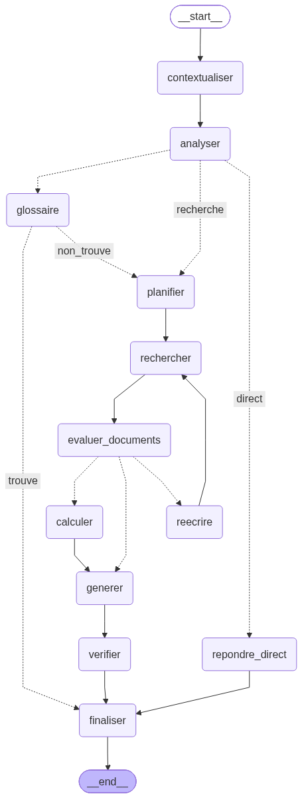
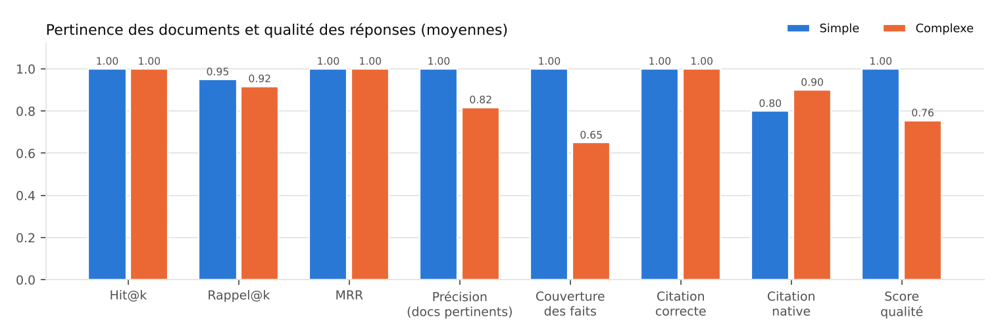
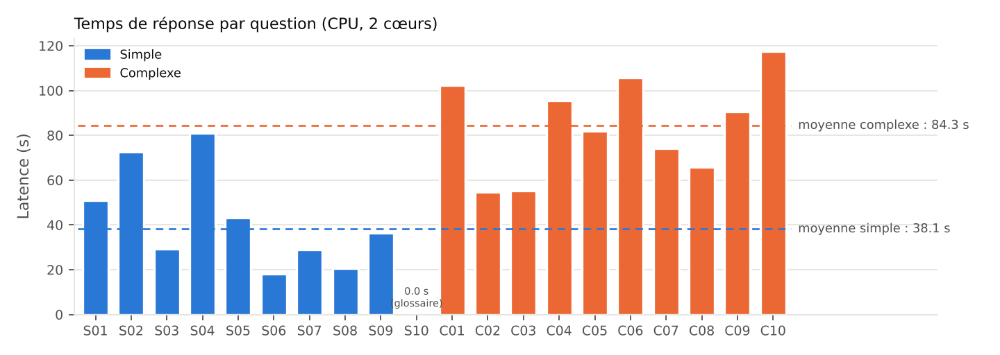

# Agentic RAG avec LangGraph — cybersécurité & réglementation numérique

Projet individuel — **Mohammed ELJIHAD**, Master II-BDCC (ENSET Mohammedia), module *SMA et IAD* (Pr. Sara RETAL).

Agent intelligent qui répond à des questions simples **et complexes** (comparaisons, multi-documents, calculs) à partir
d'une base documentaire française sur la cybersécurité et la réglementation numérique (RGPD, NIS2, lois marocaines
09-08 et 05-20, ISO 27001, rançongiciels, Zero Trust, CVSS…). Le système est un **graphe LangGraph explicite**
(`StateGraph` avec nœuds, arêtes et arêtes conditionnelles, boucle de re-recherche, mémoire `MemorySaver`) : aucun
agent préconstruit (`create_react_agent` / `create_agent`) n'est utilisé.

Tout tourne **en local sur CPU** (2 cœurs, 7 Go de RAM, sans GPU ni clé API) ; un LLM distant compatible OpenAI peut
être branché par variable d'environnement.

---

## 1. Architecture



| Nœud | Rôle | Type de décision |
|---|---|---|
| `contextualiser` | Mémoire : reformule une question de suivi (« Et quelle amende… ? ») en question autonome à partir de l'historique du `thread_id` | LLM + repli déterministe |
| `analyser` | Routeur : `direct` / `glossaire` / `recherche`, détecte complexité et besoin de calcul | règles explicites + classification LLM + garde-fou par score de similarité |
| `glossaire` | Outil `consulter_glossaire` ; si le terme est inconnu → `planifier` | arête conditionnelle |
| `planifier` | Décompose une question complexe en 2–3 sous-questions | LLM (few-shot) + analyse déterministe + repli |
| `rechercher` | Outil `rechercher_documents` (FAISS) pour chaque sous-requête, fusion/dédoublonnage | — |
| `evaluer_documents` | Note la pertinence de chaque fragment (score cosinus + jugement OUI/NON du LLM en zone grise) | hybride |
| `reecrire` | Reformule les requêtes sans document pertinent puis **reboucle** vers `rechercher` (max 2) | arête conditionnelle |
| `calculer` | Outil `calculatrice` (évaluation AST sûre) ; expression proposée par le LLM, validée, 2ᵉ tentative guidée | LLM + validation |
| `generer` | Réponse en français avec citations `[Dxx]`, à partir d'un contexte diversifié (par sous-question) et élargi aux fragments voisins | LLM |
| `verifier` | Contrôles déterministes : citations valides, phrases répétées, réponse vide, présence du résultat de calcul, indicateur d'ancrage | règles |
| `finaliser` | Ajoute la réponse à la mémoire conversationnelle (`messages`, réducteur `add_messages`) | — |

**État** (`src/state.py`) : `messages` (mémoire persistée par le checkpointer), `question_autonome`, `route`,
`sous_questions`, `requetes`, `documents` (avec verdict de pertinence), `nb_reecritures`, `calcul`, `reponse`,
`sources`, `ancrage`, `trace` (journal des nœuds avec durées).

**Outils** (`src/tools.py`, décorateur LangChain `@tool`) : `rechercher_documents`, `calculatrice`,
`consulter_glossaire`, `lister_documents`.

### Prétraitement et vectorisation
- Corpus : 15 documents Markdown avec en-tête (id, titre, catégorie) dans `data/corpus/` + glossaire de 34 acronymes
  (`data/glossaire.json`).
- Nettoyage Markdown, intertitres conservés en préfixe (« Notification : … »), découpage par paragraphes puis phrases
  (cible 650 caractères, recouvrement 120) → **58 fragments**.
- Embeddings `intfloat/multilingual-e5-small` (préfixes `passage:` / `query:`, vecteurs normalisés) ; index
  **FAISS** `IndexFlatIP` (similarité cosinus), reconstruit automatiquement s'il est absent.

### Modèle de langage
- Par défaut : **Qwen2.5-1.5B-Instruct** exécuté localement avec `transformers` sur CPU.
  En float32 le modèle ne tient pas en mémoire (OOM constaté) et en bfloat16 il est trop lent (2,4 tokens/s).
  On applique donc une **quantification dynamique int8 partielle** (`gate_proj` et `up_proj` des MLP) ; `down_proj`
  et l'attention restent en float32, car la quantification complète a été testée et détruit les sorties du modèle.
  Résultat : ~3,4 tokens/s, réponses correctes en français.
- Alternative plus rapide : `LOCAL_MODEL=Qwen/Qwen2.5-0.5B-Instruct LOCAL_QUANT=none` (≈ 6 tokens/s, qualité nettement inférieure).

---

## 2. Installation et exécution

```bash
python -m venv .venv && source .venv/bin/activate
pip install torch --index-url https://download.pytorch.org/whl/cpu
pip install -r requirements.txt

python -m src.build_index               # (optionnel) construit l'index FAISS
python -m src.visualize                 # docs/graph.mmd + docs/graph.png
python -m src.main --trace              # conversation interactive (mémoire par thread)
python -m src.main -q "Comparez les délais de notification du RGPD et de NIS2." --trace
python -m src.evaluate                  # évaluation complète (≈ 25 min sur 2 cœurs CPU)
python -m src.analyse                   # tableaux + graphiques dans results/
python scripts/make_video.py            # vidéo de démonstration à partir des résultats réels
python -m pytest -q                     # tests (sans LLM)
```

### Brancher un modèle via API (OpenAI, Groq, Mistral, Ollama, vLLM…)
```bash
export LLM_PROVIDER=openai
export LLM_BASE_URL=https://api.groq.com/openai/v1      # ou https://api.openai.com/v1, http://localhost:11434/v1 …
export LLM_MODEL=llama-3.1-8b-instant
export LLM_API_KEY=...                                  # ou OPENAI_API_KEY / GROQ_API_KEY
python -m src.main --trace
```
Le graphe ne dépend que de l'interface `chat(messages, max_new_tokens)` (`src/llm.py`). Voir `.env.example`.

---

## 3. Évaluation (résultats réels)

`eval/questions.json` contient **10 questions simples** et **10 questions complexes** (comparaisons, multi-documents,
calculs), chacune avec ses sources attendues et ses faits clés. Toutes les valeurs ci-dessous sont produites par
`src/evaluate.py` (aucune saisie manuelle) ; les fichiers bruts sont dans `results/`.

Métriques :
- **Hit@k / Rappel@k / MRR** : présence, proportion et rang des sources attendues parmi les documents récupérés.
- **Précision des documents pertinents** : part des documents retenus par `evaluer_documents` qui sont attendus.
- **Couverture des faits** : part des faits clés attendus présents dans la réponse (comparaison normalisée, sans accents).
- **Citation correcte** : au moins une source citée est attendue (le nœud `verifier` peut ajouter les sources) ;
  **citation native** : idem, mais citée par le LLM lui-même.
- **Score qualité** = 0,7 × couverture des faits + 0,3 × citation correcte (score automatique, approximatif).

**Configuration de la version finale** : Qwen2.5-1.5B-Instruct (int8 gate/up), e5-small, top-k = 4 par sous-requête,
seuils de pertinence 0,82 / 0,88, 2 réécritures max, CPU 2 cœurs. Durée totale : 1 340 s (20 questions + démonstration
mémoire), dont 34,8 s de chargement/préchauffage exclus des latences.

| Groupe | Latence moy. (s) | Hit@k | Rappel@k | MRR | Précision pert. | Couverture faits | Citation (native) | Score qualité | Jugement manuel |
|---|---|---|---|---|---|---|---|---|---|
| Simples (10) | 38,1 | 1,00 | 0,95 | 1,00 | 1,00 | 1,00 | 1,00 (0,80) | **1,00** | 10 corrects |
| Complexes (10) | 84,3 | 1,00 | 0,92 | 1,00 | 0,82 | 0,65 | 1,00 (0,90) | **0,76** | 4 corrects, 5 partiels, 1 incorrect |
| Global (20) | 61,2 | 1,00 | 0,93 | 1,00 | 0,90 | 0,83 | 1,00 (0,85) | **0,88** | 14 / 5 / 1 |




**Itérations** (toutes conservées dans `results/v1`, `results/v2`) :
- *v1* : le contexte ne contenait parfois qu'un fragment, ce qui coupait une liste (S04 : 1 phase NIST sur 4) ; la
  calculatrice acceptait une « expression » sans opération. → contexte diversifié par sous-question et élargi aux
  fragments voisins, validation de l'expression. Score qualité 0,837 → 0,878.
- *v2* : la couverture des requêtes reformulées n'était pas rattachée à la sous-question d'origine, d'où des boucles
  de réécriture inutiles (C06, C07). → suivi des `origines` + arrêt si une reformulation n'apporte aucun nouveau
  fragment, et détection du besoin de calcul limitée aux quantités avec unité. Réponses identiques (décodage
  glouton), latence moyenne des questions complexes 94,7 s → 84,3 s.
- La boucle de réécriture est démontrée hors jeu de test (`scripts/demo_reecriture.py`, `results/demo_reecriture.json`) :
  « OIV obligations » → 0/4 fragment pertinent → reformulation → nouvelle recherche → 1 fragment pertinent (D09).

**Limites observées** : le score automatique surestime certaines réponses (C10 : « 21 » trouvé dans un raisonnement
faux) ; attributions de sources parfois erronées (C08, C09) ; le routeur LLM s'est trompé 2 fois (DIRECT au lieu de
RECHERCHE), corrigé à chaque fois par le garde-fou de similarité.

Fichiers : `results/eval_results.json` (réponses, traces complètes, durées par nœud), `results/eval_results.csv`,
`results/summary.md`, `results/latence_par_question.png`, `results/metriques_par_type.png`,
`results/memoire_demo.json` (démonstration de la mémoire sur deux tours) et `results/v1/` (première itération,
avant corrections).

---

## 4. Structure du dépôt

```
agentic-rag-langgraph/
├── data/corpus/          15 documents (rédigés par l'auteur) ; data/glossaire.json
├── src/
│   ├── config.py         paramètres (surcharge par variables d'environnement)
│   ├── ingestion.py      lecture, nettoyage, découpage
│   ├── vectorstore.py    embeddings e5 + index FAISS
│   ├── build_index.py    construction de l'index
│   ├── llm.py            LLM local (transformers, int8 partiel) ou API compatible OpenAI
│   ├── tools.py          outils LangChain (@tool)
│   ├── prompts.py        prompts français
│   ├── state.py          état du graphe
│   ├── nodes.py          nœuds + fonctions de routage
│   ├── graph.py          StateGraph + MemorySaver
│   ├── main.py           interface en ligne de commande
│   ├── visualize.py      export Mermaid / PNG du graphe
│   ├── evaluate.py       évaluation 10 + 10 questions
│   └── analyse.py        synthèse et graphiques
├── eval/questions.json   jeu d'évaluation
├── results/              résultats bruts, synthèses, graphiques
├── docs/                 graph.mmd, graph.png
├── scripts/            make_video.py (vidéo), demo_reecriture.py (boucle de réécriture)
├── tests/              tests des composants déterministes (pytest)
└── rapport/              source du rapport PDF
```

## 5. Corpus et licence
Les 15 documents du corpus ont été **rédigés par l'auteur** à des fins pédagogiques, sous forme de synthèses
simplifiées de textes publics (RGPD, directive NIS2, lois marocaines 09-08 et 05-20, guides NIST, OWASP, ISO 27001).
Ils ne reproduisent aucun texte protégé et **ne constituent pas un avis juridique**. Code sous licence MIT.
